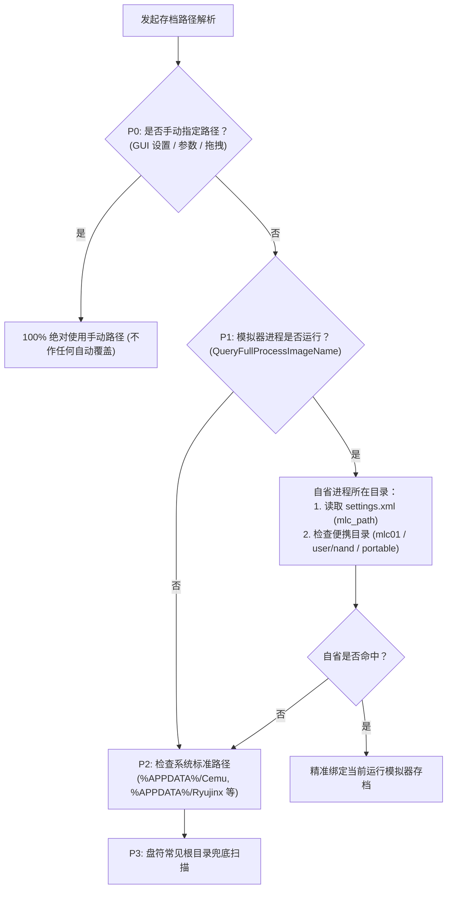
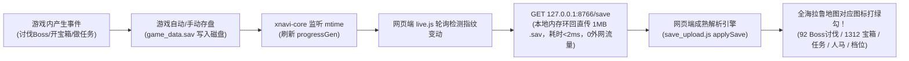

# xnavi v3.2.0 版本与架构技术报告（2026-10-22）

## 1. 版本概述
xnavi v3.2.0 是定位器与存档架构的一次里程碑式彻底重构。本次重构终结了多模拟器代码相互踩脚、逻辑冗余散落、假锁掉锁频发的历史技术债务，全面践行 Enavi「做减法、根源治理、简单高效」的核心哲学：
1. **三大模拟器定位流水线解耦与统一**：
   - 彻底物理拆分为独立管道（`watch_cemu.go` / `watch_ryujinx.go` / `watch_eden.go`），分发调度器（`watch.go`）仅保留生命周期分发；
   - **哲学统一（只锁动力学根地址）**：Eden 与 Ryujinx 全面统一采用动力学根运动 RingBuffer 扫描与死读；彻底废除 Ryujinx 容易被骑乘置零的外观槽 `0xA77FCBBC`，删除 `findMountActor` 等骑乘补丁，骑马、大师摩托车、盾滑全场景自然连续实时跟随；
   - **死守 lockedAddr**：彻底取消黑屏超时主动丢锁与盲猜重扫；跨区大传送直接采纳新坐标，落地秒级接管，全链路零多余操作；
2. **全模拟器存档路径自省（Process-Anchored Save Resolution）**：
   - 彻底终结跨版本（Cemu 1.26 便携版 vs 2.6 AppData、Eden 0.21 vs Nightly）存档串台难题；
   - 优先以当前附加进程的真实 `exe` 目录自省其专属配置（`<mlc_path>`、便携 `mlc01`、`user/nand`）；
   - 手动设置路径享有最高优先权（P0），支持一键定位文件、手动指定与拖拽（Drag & Drop）导入；
3. **神庙地下物理判据与门禁修正**：
   - 确立神庙内部核心判据为垂直海拔 `Y < 50m`（大世界平原地表海拔普遍 `Y > 100m`，地表绝无可能 `Y < 50m`），水平范围放宽至 `|X| < 300m && |Z| < 300m`，彻底解决 DLC 罗塔·奇格尔走廊神庙（`Z = 108.9m`）红点飞到海拉鲁平原的缺陷，且杜绝神庙门口传送误判；
   - 严守 `verified=false` 门禁，避免离存档点过远时误锁静止碎片，提供走动与存盘引导；
4. **全量探索度同步（任务 / 宝箱 / 讨伐 / 人马 / 世界档位全自动打勾）**：
   - 架构大减法：不重复在 Go 端搬运数万行字典；在服务端开辟 `GET /save` 二进制直通管道；
   - 网页端（`live.js`）在游戏存盘时自动从 `/save` 获取最新存档并激活成熟的 `save_upload.js` 解析引擎，全图 92 个 Boss 讨伐、1312 个宝箱、全部任务、人马分级击杀与世界积分档位全部全自动、秒级打勾！

---

## 2. 核心架构与功能清单

### 2.1 三大独立物理追踪管道
| 模拟器 | 管道文件 | 核心锁定机制 | 骑乘 / 盾滑表现 | 传送与神庙表现 |
|---|---|---|---|---|
| **Cemu** (Wii U) | `watch_cemu.go` | 固定偏移（Root 物理动力学控制器 `0x1055300C`），大端直读，零重扫 | 每一帧物理写入，自然跟随，零掉锁 | 传送落地直接接管；进庙门口平滑挂起，出庙秒级恢复 |
| **Ryujinx** (Switch) | `watch_ryujinx.go` | 动力学根运动 RingBuffer 扫描锁定（`FindEdenTriples`），小端直读 | 废除外观 Transform 槽，直接读动力学根对象，自然跟随，零掉锁 | 传送落地直接接管；进庙门口平滑挂起，出庙秒级恢复 |
| **Eden** (Switch) | `watch_eden.go` | User Heap 2.65GB 锚点窗口扫描（`RunLength >= 2`），多候选走动仲裁 | 动力学根对象持续写入，自然跟随，零掉锁 | 传送落地直接接管，零重扫；进庙门口平滑挂起，出庙秒级恢复 |

### 2.2 存档路径四级阶梯发现策略

### 2.3 全量探索度直通架构（方案 B）

---

## 3. 踩坑记录与根本原因复盘台账

| 事故与异常现象 | 表面诱因 | 物理底层根本原因 | 根源治理修法 |
|---|---|---|---|
| **Eden 传送过图后丢失定位** | 传送黑屏持续 6~8 秒，红点掉锁 | 旧代码设置了 6 秒读失败主动重扫逻辑；而传送落地时自动存档尚未写盘，重扫以旧起点坐标为中心，锁到了起点残留的废弃内存镜像（死锁） | **死守 lockedAddr**：彻底取消黑屏超时主动掉锁（Kill timeout reset）。过图黑屏平滑保持上一帧，落地直接接管新落点坐标（`delta > 300m -> [warp]`），全链路零掉锁、零重扫，用户零操作。 |
| **Ryujinx 骑车、盾滑丢失定位，日志狂刷虚假 `[warp]`** | 骑马、骑摩托车、盾滑时定位丢失，下车瞬间恢复，日志中大量 `(0, 0, Z)` 刷屏 | 1. Ryujinx 原固定偏移 `0xA77FCBBC` 是外观骨骼 Transform 槽，进入附着状态会被引擎复用为标志位 `(X=0, Y=1)`； 2. `WorldCoordOK` 漏判了 `(0, 0, Z)`，误当成合法世界坐标，与上一帧产生 500m 突跳，误触发 `[warp]` | 1. 坐标门禁严正拒收 `(0, 0, Z)` 退化向量； 2. 架构统一：Ryujinx 彻底改用与 Eden 相同的动力学根运动缓冲，锁定根动力学地址，彻底废除 `findMountActor` 等骑乘补丁。 |
| **Cemu 1.26 便携版读取到 Cemu 2.6 的 AppData 存档** | 更换运行便携版 Cemu，探索度与定位锚点仍然来自旧版本 | 旧代码采取静态盲搜路径列表，优先命中了 `%APPDATA%\Cemu`，对当前真正活着的 `Cemu.exe` 所在目录毫不知情 | **进程路径自省（Process-Anchored）**：获取当前运行进程真实路径，优先读取其自身的 `settings.xml`（`<mlc_path>`）及便携 `mlc01`，实现 100% 精准绑定；叠加手动指定 P0 级最高优先。 |
| **DLC 罗塔·奇格尔神庙进庙后红点飞到海拉鲁平原** | 进罗塔·奇格尔神庙红点飞到式典场遗迹，出庙跳回 | 罗塔·奇格尔是一击必杀之剑的长廊关卡，进门初始点 `Z = 108.9m`；原 `isShrineScale` 写死了 `|Z| < 100m`，导致其因超标 8.9 米被误判为大世界 | **确立海拔高程为核心判据**：地下神庙海拔恒为 `Y < 50m`（大世界平原地表海拔普遍 `Y > 100m`，地表绝无 `Y < 50m`）。水平范围放宽至 300m，完美兼容 136 座神庙全量包围盒，并杜绝神庙门口传送误判。 |
| **Eden 存档陈旧（147分钟前）时初次定位不跟随** | 启动后红点停在半路不跟随，存盘后瞬间自愈 | 存档陈旧时真实玩家已在 204m 外，120m 锚点窗口内只有残留的局部静态碎片（`run=8`）；原门槛 `Run >= 2` 误将其锁死 | 坚决不盲目扩大半径打补丁；**严守 `verified=false` 门禁**，若持续未确认主角走动，状态显示 `UNVERIFIED`，日志与界面友好引导用户按 `[+]` 存盘秒锁。 |
| **游戏中打死 Boss 地图不自动打勾** | 必须手动拖入存档才更新讨伐/宝箱/任务 | xnavi 旧版 `/progress` 接口只内嵌了 5 个大类（1078 点），不支持宝箱（1312个）、Boss讨伐（92个）等复杂大字典 | **新增 `/save` 本地直通管道**：直接将 1MB 原始存档内存流传给网页端现成成熟的 `save_upload.js` 解析引擎，两端无缝闭环，全探索度秒级全自动打勾。 |

---

## 4. 规范与后续维护指引

1. **修改流程铁律**：
   - 方案先行，讨论确认后再动手，严禁未经确认直接修改生产代码；
   - 遇现实问题，坚决不习惯性打补丁、调参数、调延时，必须深挖物理根本原因，从架构上寻找最简单优美的解法。
2. **核心流水线零改动原则**：
   - 当前 Cemu、Ryujinx、Eden 三大流水线（`watch_*.go`）定位逻辑已经完全成熟稳定，后续新增功能（如 TOTK 支持、UI 优化、新探索项）必须严格物理隔离，不得污染已验证的 BOTW 定位主干。
3. **网页静态资源发布规则**：
   - 网页静态资源修改（如 `live.js` / `save_upload.js`）提交前，必须同步 bump `app/index.html` 的 `?v=` 参数，防止 CDN 长缓存导致用户端版本不同步。
4. **Git 推送规范**：
   - push 仅推 `main` 分支，禁止推 `master`；
   - push 后必须执行 `git ls-remote` 核对远端哈希与本地 `HEAD` 一致。
